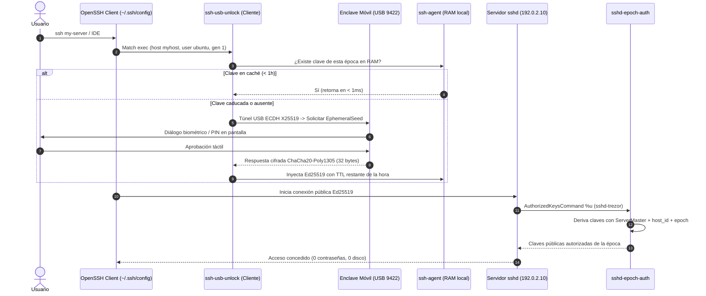

# Guía de Implementación y Despliegue: Zero-Trust Stateless SSH

Esta guía documenta paso a paso el proceso de despliegue, endurecimiento (hardening) y configuración extremo a extremo del sistema **Zero-Trust Stateless SSH** entre una estación de trabajo cliente (macOS/Linux/Windows) y un servidor Linux (ejemplo: `myhost`, IP: `192.0.2.10`).

---

## 1. Arquitectura del Sistema

El sistema implementa autenticación SSH sin estado (*stateless*) basada en épocas horarias (*epochs* de 3600 segundos), eliminando claves estáticas (`~/.ssh/authorized_keys`) y contraseñas.



---

## 2. Fase 1: Hardening Base del Servidor Linux

**Entorno de referencia:**
* **Sistema:** Ubuntu LTS (`x86_64` / `arm64`)
* **Hostname:** `myhost`
* **IP de ejemplo:** `192.0.2.10`
* **Usuario:** `ubuntu`

### 2.1 Actualización del Sistema y Paquetes Base
Se ejecutó la actualización desatendida y se instalaron herramientas esenciales de compilación y diagnóstico:
```bash
export DEBIAN_FRONTEND=noninteractive
sudo apt-get update -qq
sudo apt-get upgrade -y -qq
sudo apt-get install -y -qq \
    build-essential pkg-config libssl-dev \
    htop tmux tree ripgrep net-tools unzip ncdu \
    fail2ban unattended-upgrades
```

### 2.2 Protección contra Fuerza Bruta (Fail2ban)
Se configuró una jaula estricta para SSH mediante `/etc/fail2ban/jail.local`:
```ini
[DEFAULT]
bantime = 1h
findtime = 10m
maxretry = 5

[sshd]
enabled = true
port = ssh
backend = systemd
```
Habilitación del servicio:
```bash
sudo systemctl enable fail2ban
sudo systemctl restart fail2ban
```

### 2.3 Cortafuegos Perimetral (UFW)
Se cerró todo el tráfico entrante no autorizado y se garantizó la persistencia del puerto SSH:
```bash
sudo ufw default deny incoming
sudo ufw default allow outgoing
sudo ufw allow 22/tcp comment 'SSH'
sudo ufw --force enable
```

### 2.4 Actualizaciones Automáticas de Seguridad
```bash
sudo systemctl enable unattended-upgrades
sudo systemctl restart unattended-upgrades
```

---

## 3. Fase 2: Compilación Cruzada del Daemon `sshd-epoch-auth`

El componente servidor `sshd-epoch-auth` debe ejecutarse en Linux con mínimas dependencias y máxima portabilidad.

Se compiló desde macOS utilizando `cargo zigbuild` apuntando al target **musl** estático:
```bash
cargo zigbuild --bin sshd-epoch-auth --release --target x86_64-unknown-linux-musl
```

* **Resultado:** Binario ELF de 64 bits, enlazado estáticamente (`statically linked, stripped`), tamaño aproximado ~400 KB.
* **Ubicación local:** `target/x86_64-unknown-linux-musl/release/sshd-epoch-auth`

---

## 4. Fase 3: Despliegue de Zero-Trust SSH en el Servidor

### 4.1 Opción A (Recomendada): Instalador automático del servidor vía GitHub Releases
Ejecuta directamente en el servidor Linux (descarga el binario estático `sshd-epoch-auth` para `x86_64` o `arm64`, verifica `SHA256SUMS.txt` y aprovisiona OpenSSH):
```bash
curl -fsSL https://github.com/Kerwit/zero-trust-ssh/releases/latest/download/install-server.sh | sudo sh -s -- <SERVER_MASTER_HEX_64>
```
*(Para descargar o actualizar únicamente `/usr/local/bin/sshd-epoch-auth` sin tocar la configuración de `sshd`, añade `--binary-only`.)*

### 4.2 Opción B (Manual): Transferencia de Archivos y Aprovisionamiento Local
```bash
scp scripts/install_sshd_zero_trust.sh \
    target/x86_64-unknown-linux-musl/release/sshd-epoch-auth \
    ubuntu@192.0.2.10:/tmp/
```
```bash
sudo /tmp/install_sshd_zero_trust.sh /tmp/sshd-epoch-auth <SERVER_MASTER_HEX_64>
```

**Acciones automatizadas por el script:**
1. **Creación del usuario no privilegiado:**
   ```bash
   useradd --system --no-create-home --shell /usr/sbin/nologin sshd-trezor
   ```
2. **Instalación del binario:**
   ```bash
   install -o root -g root -m 0755 /tmp/sshd-epoch-auth /usr/local/bin/sshd-epoch-auth
   ```
3. **Aprovisionamiento blindado de la clave maestra:**
   * Archivo: `/etc/ssh/trezor_master.key`
   * Permisos: `0440 root:sshd-trezor`
   * Inmutabilidad en sistema de archivos: `chattr +i /etc/ssh/trezor_master.key`
4. **Autodiagnóstico previo a la activación:**
   Ejecuta el binario como usuario `sshd-trezor` para verificar que la salida comienza con `ssh-ed25519`.
5. **Configuración de OpenSSH (Drop-in):**
   Archivo `/etc/ssh/sshd_config.d/00-zero-trust-epoch.conf`:
   ```ssh
   PubkeyAuthentication yes
   PasswordAuthentication no
   KbdInteractiveAuthentication no
   PermitEmptyPasswords no
   AuthorizedKeysFile none
   AuthorizedKeysCommand /usr/local/bin/sshd-epoch-auth %u
   AuthorizedKeysCommandUser sshd-trezor
   KexAlgorithms sntrup761x25519-sha512@openssh.com,curve25519-sha256
   ```
6. **Validación y Recarga:**
   `sshd -t` valida la sintaxis y recarga el servicio `systemctl reload sshd`.

---

## 5. Fase 4: Configuración del Cliente (macOS / Linux / Windows)

### 5.1 Instalación rápida del CLI cliente (`ssh-usb-unlock`)
En tu estación de trabajo (PC/Mac):
```sh
# macOS y Linux
curl -fsSL https://github.com/Kerwit/zero-trust-ssh/releases/latest/download/install.sh | sh
```
```cmd
# Windows (CMD / PowerShell)
curl.exe -fsSL https://github.com/Kerwit/zero-trust-ssh/releases/latest/download/install.ps1 | powershell -NoProfile -ExecutionPolicy Bypass -Command -
```
Luego vincula el servidor de forma interactiva (actualiza `~/.ssh/config` y `~/.ssh/known_hosts` automáticamente):
```sh
ssh-usb-unlock link
```

### 5.2 Registro Manual de Huella del Host (`known_hosts`)
Para evitar que las herramientas no interactivas (VS Code Remote SSH / IDEs) fallen con `Host key verification failed`:
```bash
ssh-keyscan -H 192.0.2.10 >> ~/.ssh/known_hosts
echo "my-server,192.0.2.10 ssh-ed25519 <HOST_ED25519_PUBKEY>" >> ~/.ssh/known_hosts
```

### 5.2 Corrección de Detección de ADB en `ssh-usb-unlock`
En macOS, `adb` suele ubicarse en `~/Library/Android/sdk/platform-tools/adb`. Se actualizó `ssh-usb-unlock/src/usb_tunnel.rs` para resolver esta ruta automáticamente en caso de no encontrarse en el `PATH` global:
```rust
fn ensure_usb_port_forward() {
    let mut candidates = vec!["adb".to_string()];
    if let Ok(home) = std::env::var("HOME") {
        candidates.push(format!("{}/Library/Android/sdk/platform-tools/adb", home));
    }
    for candidate in candidates {
        if let Ok(status) = Command::new(&candidate)
            .args(["forward", "tcp:9422", "tcp:9422"])
            .stdout(Stdio::null())
            .stderr(Stdio::null())
            .status()
        {
            if status.success() {
                break;
            }
        }
    }
}
```
Recompilación del cliente:
```bash
cargo build --release -p ssh-usb-unlock
```

### 5.3 Configuración Canónica de `~/.ssh/config`
Se estructuró el archivo `~/.ssh/config` para asegurar que el usuario y la generación coincidan con el Enclave Móvil:
```ssh
Host my-server 192.0.2.10
    HostName 192.0.2.10
    User ubuntu

Match host my-server,192.0.2.10 exec "~/.ssh/ssh-usb-unlock myhost ubuntu 1"
```

* **`myhost` (1er argumento):** `host_id` registrado en el servidor (`/etc/hostname`).
* **`ubuntu` (2do argumento):** Usuario de acceso SSH en el servidor.
* **`1` (3er argumento):** Número de generación de clave activa en la aplicación móvil.

---

## 6. Verificación y Troubleshooting

### Comprobar Clave en Memoria Local (`ssh-agent`)
```bash
ssh-add -l
```
Salida esperada:
```
256 SHA256:... trezor-epoch:myhost:ubuntu:498445 (ED25519)
```

### Probar Conexión SSH
```bash
ssh my-server "uptime"
ssh 192.0.2.10 "uptime"
```

### Resolución de Incidencias Comunes

| Error | Causa | Solución |
|---|---|---|
| `ERR:Generation mismatch` | La generación pasada al binario no coincide con la de la app | Especificar la generación correcta en `~/.ssh/config` (p. ej. `1`). |
| `ERR:Host not registered` | El `host_id` enviado difiere del configurado en la app | Comprobar `cat /etc/hostname` en el servidor (en minúsculas). |
| `Connection refused (9422)` | No hay túnel USB activo con el móvil | Conectar cable USB y ejecutar `adb forward tcp:9422 tcp:9422`. |
| `Permission denied (publickey)` | Clave de época no cargada o caducada | Re-ejecutar `ssh-usb-unlock` y confirmar el aviso en la pantalla del móvil. |

